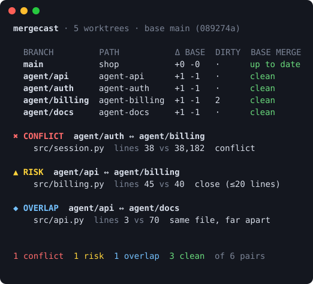

<div align="center">

# mergecast

**A weather forecast for your merge conflicts.**
See which parallel git worktrees — and AI coding agents — are about to collide, *before* you're stuck resolving it.

[](https://github.com/Nithinfgs/mergecast/actions/workflows/ci.yml)
[](LICENSE)




</div>

```bash
pipx install git+https://github.com/Nithinfgs/mergecast
cd your-repo && mergecast
```

## Why

Running Claude Code, Codex, Cursor or Aider in several `git worktree`s at once is now normal, and tools like
[Orca](https://github.com/stablyai/orca) and [Herdr](https://github.com/herdrdev/herdr) make it easy to launch a fleet.
The pain arrives later: three agents finish, and two of them rewrote the same function. Nobody noticed until merge time.

`mergecast` looks at **every worktree of the repo, including uncommitted and untracked work**, and tells you now:

| Level | Meaning |
|---|---|
| ✖ **conflict** | git itself cannot merge these two (simulated in memory with `git merge-tree`) |
| ▲ **risk** | same file, edits within `--near` lines (default 20). Git merges it, but the result is worth a look |
| ◆ **overlap** | same file, edits far apart |
| ✔ **clean** | no shared files |

It also reports how far each branch is ahead of/behind your base branch and whether it would conflict with it.

## Features

- **Includes uncommitted work.** Dirty and untracked files are snapshotted via a private copy of the index, so an agent that hasn't committed yet still shows up.
- **Read-only.** Never touches your working trees, real index, branches or config. The only writes are unreachable snapshot objects, which `git gc` prunes. Covered by a test.
- **Line-range detail.** Shows *which* lines each side edited, so you can judge severity at a glance.
- **`who`: ask before you edit.** `mergecast who src/api.py` lists other worktrees already changing that file. Hook it into your agent (see [examples](examples/)).
- **Script-friendly.** `--format json|md`, `--fail-on conflict|risk|overlap` exit codes, `NO_COLOR` support.
- **`watch` mode.** A live-updating view in a spare terminal pane.
- **Zero dependencies.** Pure Python standard library plus `git ≥ 2.38`.
- **Agent-agnostic.** It only reads git, so it works with any tool that uses worktrees or branches.

## Install

Requires Python 3.9+ and git 2.38+ (for `git merge-tree --write-tree`).

```bash
pipx install git+https://github.com/Nithinfgs/mergecast     # recommended
# or
pip install git+https://github.com/Nithinfgs/mergecast
# or from a clone
git clone https://github.com/Nithinfgs/mergecast && cd mergecast && pip install -e .
```

## Usage

```bash
mergecast                          # forecast for the repo in the current directory
mergecast watch                    # refresh every 3s
mergecast scan --format json       # machine-readable
mergecast scan --format md         # paste into a PR or chat
mergecast --fail-on conflict       # exit 1 in scripts/hooks if any pair conflicts
mergecast --base origin/develop    # compare against another base
mergecast --committed-only         # ignore uncommitted work
mergecast --near 5 -v              # stricter "risk" window, list every file
mergecast who 'src/auth/*'         # who else is touching these paths?
mergecast who src/api.py --check   # exit 1 if another worktree touches it
```

Try it on a throwaway repo with four colliding "agents":

```bash
scripts/demo_repo.sh          # builds /tmp/mergecast-demo
cd /tmp/mergecast-demo/shop && mergecast
```

Exit codes: `0` ok · `1` threshold reached (`--fail-on`) or `who --check` matched · `2` error.

## How it works

For every pair of worktrees mergecast (1) snapshots each one (`HEAD` plus dirty files) into a commit object using a temporary index,
(2) runs `git merge-tree --write-tree` to simulate the merge in memory, and (3) diffs each side against the merge-base
to find shared files and their edited line ranges. Pairs are analysed in parallel. A clean checkout of your base branch is
skipped as a peer, since it has nothing to collide. More in [docs/architecture.md](docs/architecture.md).

## What it does *not* do

- It detects **textual** conflicts and proximity, not **semantic** ones. If one agent renames a function and another adds a caller, git and mergecast both see a clean merge. "Risk" is a heuristic nudge, not a proof.
- It compares against your *local* base ref. Run `git fetch` for an up-to-date view of `origin`.
- It doesn't resolve anything for you. It tells you where to look.

## Use cases

- Running a fleet of coding agents in parallel worktrees, and deciding merge order or when to intervene.
- Feature-branch teams working on one machine with several checkouts.
- A pre-push guard, or a "don't edit this file, someone else has it" hook for agents.

## Roadmap

- Symbol-level overlap (tree-sitter) to catch renamed-function-vs-new-caller collisions
- Compare against remote branches and open PRs, not just local worktrees
- Suggested merge order that minimises conflicts
- Optional MCP server so agents can query the forecast directly
- Desktop notification on new conflicts in `watch`

## Contributing

Issues and PRs welcome. See [CONTRIBUTING.md](CONTRIBUTING.md).

```bash
git clone https://github.com/Nithinfgs/mergecast && cd mergecast
python3 -m venv .venv && . .venv/bin/activate && pip install -e ".[dev]"
pytest && ruff check . && mypy src
```

## License

[MIT](LICENSE)
